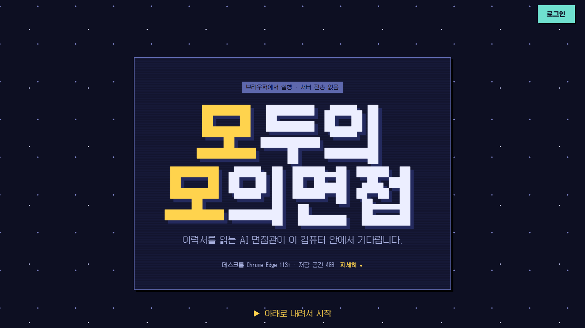
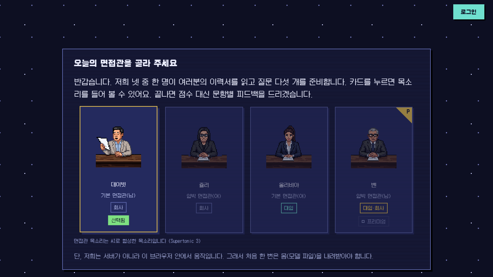
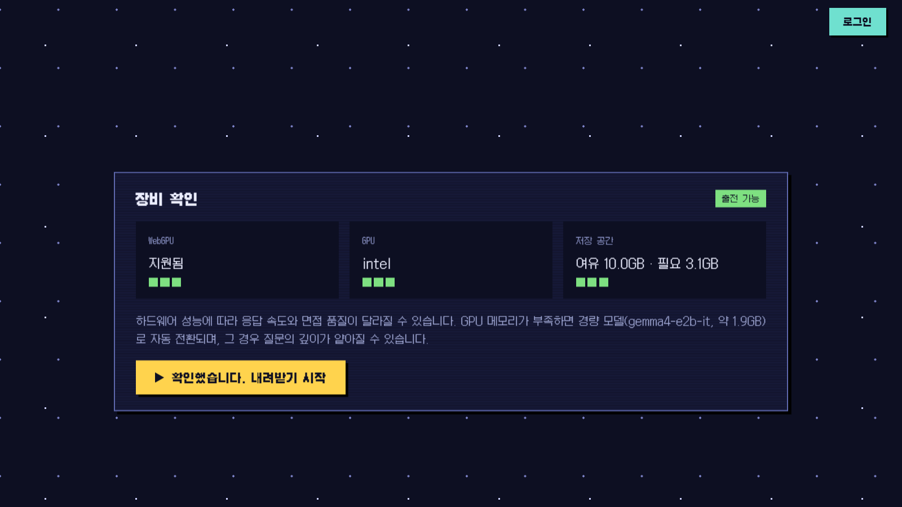
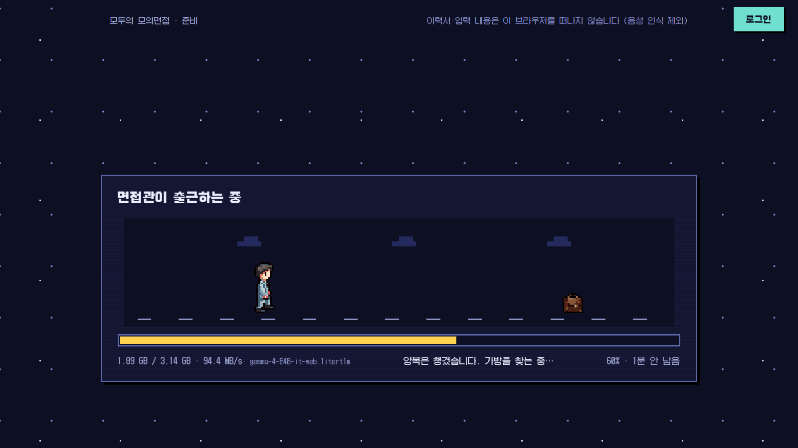
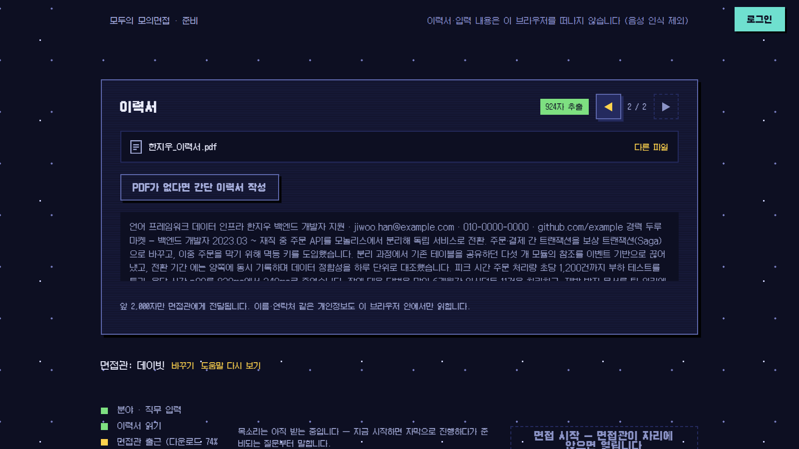
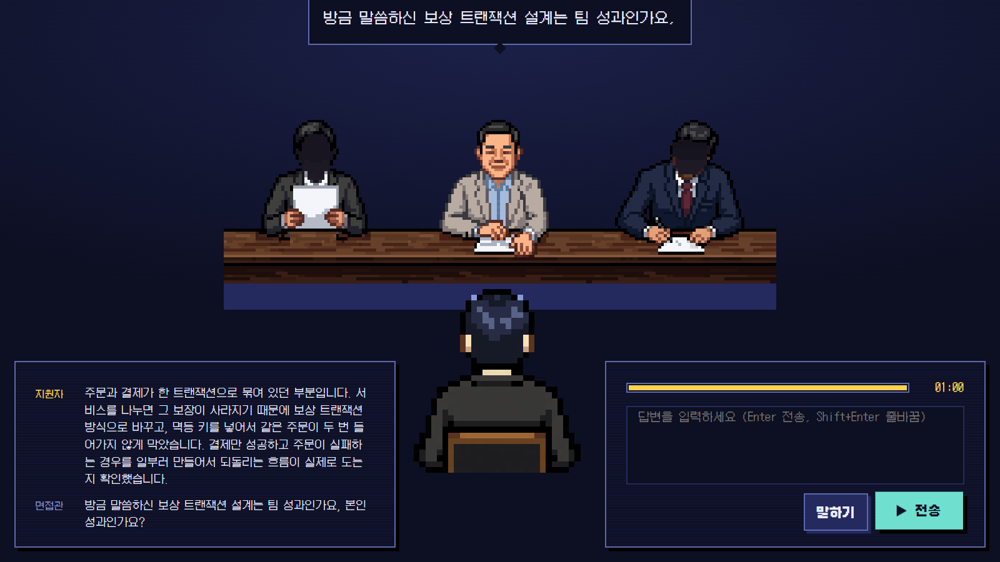
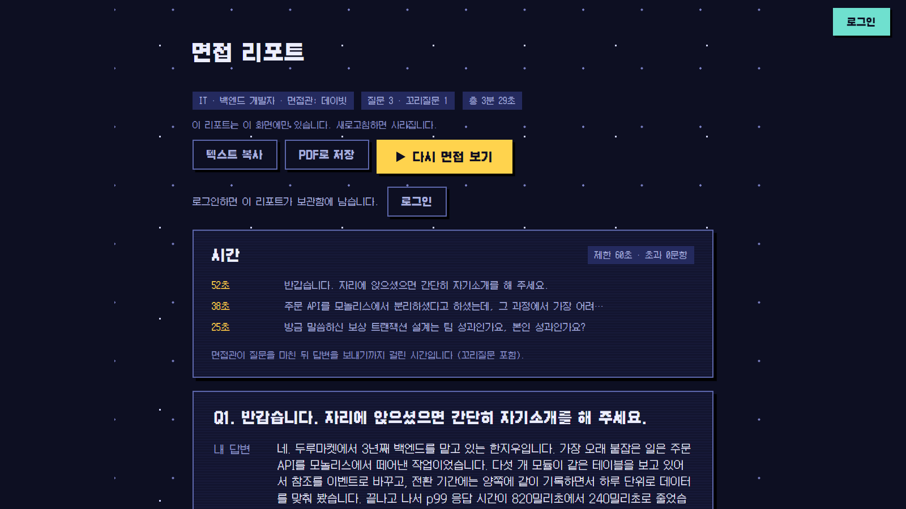
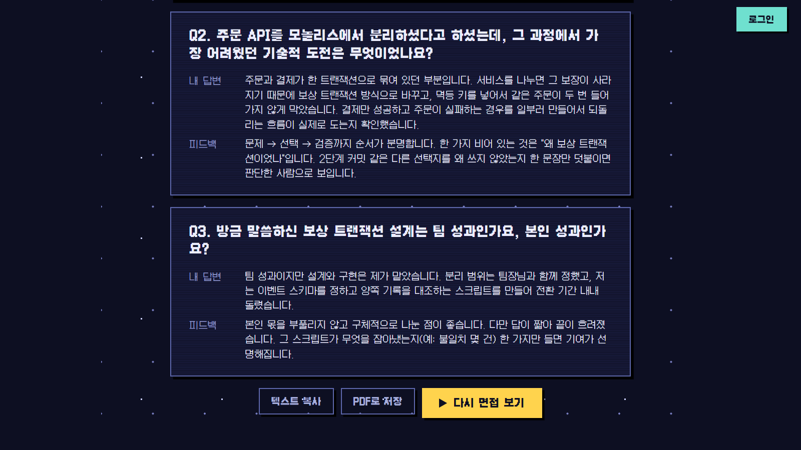

# 모두의 모의면접

**이력서가 내 컴퓨터를 떠나지 않는, 브라우저 속 AI 면접관**

- 서비스: **https://momo.ssenu.cloud**
- 2026 창의적 종합설계 경진대회 출품작 (명지전문대학 정보통신공학과, 팀 Woo)



## 해결하고자 한 문제

AI 모의면접을 하려면 이력서와 답변 같은 민감한 개인정보를 외부 서버에 넘겨야 합니다. 이 문제를 **AI 추론을 사용자 브라우저 안에서 실행**하는 방식으로 풀었습니다.

- 이력서(이름·연락처·학력·경력)는 취업 준비생에게 가장 민감한 개인정보입니다. 서버에 올리는 순간 어디에 저장되고 어떻게 쓰이는지 사용자가 알기 어렵습니다.
- 사람과 하는 모의면접은 비용과 시간이 들고, 원할 때 반복하기 어렵습니다.
- 점수보다 **답변마다 무엇을 고쳐야 하는지**가 연습에 더 도움이 됩니다.

## 어떻게 동작하나요

| 1. 면접관 고르기 | 2. 받을 것을 먼저 보여 주고 동의받기 |
|---|---|
|  |  |
| 무료 면접관 셋과 프리미엄 면접관 벤. 카드를 누르면 목소리를 미리 들어 봅니다. | 무엇을 얼마나 받는지, 어디에 저장되는지 표로 보여 준 뒤 동의를 받습니다. |
| **3. 받는 동안 면접관이 출근** | **4. 이력서 넣기** |
|  |  |
| 약 3.1GB를 받는 동안 면접관이 옷을 입고 가방을 챙겨 출근합니다. 진행률이 곧 애니메이션입니다. | PDF를 올리면 브라우저가 글자를 뽑습니다. 파일은 기기를 떠나지 않습니다. |

### 면접

면접관이 이력서를 바탕으로 질문 5개를 하고, 답이 얕으면 꼬리질문으로 파고듭니다. 답은 글로 쓰거나 말로 할 수 있고, 문항마다 60초 타이머가 있습니다.



### 리포트 — 점수 대신 고칠 점

| 전체 | 문항별 |
|---|---|
|  |  |

점수를 매기지 않습니다. **내가 한 말을 그대로** 보여 주고 문항마다 무엇을 바꾸면 좋을지 짚습니다. 답변에 걸린 시간도 함께 정리하고, 텍스트 복사와 PDF 저장을 지원합니다.

## 개인정보 설계

데이터가 어디까지 가는지를 **이용 단계로 갈랐습니다.** 화면에도 같은 기호로 계속 표시합니다.

| 단계 | 이력서·대화·리포트 | 설명 |
|---|---|---|
| **비로그인** | 기기 밖으로 **0바이트** | 서버에 이 데이터를 받는 API가 처음부터 없습니다 |
| **로그인** | 동의 범위 안에서만 서버 보관 | 이력서 슬롯, 면접 기록 보관함, 답변 녹음 |
| **프리미엄(벤)** | 외부 AI로 전송 | 면접 시작 전에 반드시 알립니다 |

- 무료 면접관의 LLM·목소리 합성·PDF 읽기는 전부 브라우저에서 돌아갑니다. 모델 파일은 Hugging Face 원본에서 브라우저가 직접 받습니다.
- 비로그인 리포트는 그 화면에만 있고, 새로고침하면 사라집니다.
- 목소리 분석은 **동의한 면접에서만** 녹음을 보내고, 분석이 끝나면 서버의 녹음을 바로 지웁니다.
- 비밀번호·이력서·대화 본문은 로그에 남기지 않습니다.

## 프리미엄 면접관 — 벤

브라우저 추론에는 대가가 있었습니다. 3.1GB를 받아야 하고, WebGPU를 지원하는 데스크톱이 필요하며, 휴대폰에서는 아예 돌릴 수 없습니다. 그래서 **기다리기 싫거나 장비가 없는 사람에게는 서버가 대신 답하는 면접관**을 두었습니다.

| 기능 | 내용 |
|---|---|
| 바로 시작 | 다운로드 없이, 휴대폰·저사양 기기에서도 |
| 회사 브리핑 | 회사명을 넣으면 면접 전에 웹을 검색해 사업·최근 소식·기술·인재상을 정리 |
| 모집공고 반영 | 공고 링크를 주면 공고를 읽고 요구 기술을 이력서와 연결해 질문 |
| 전달력 분석 | 말 속도·쉼·첫마디까지 걸린 시간을 **브라우저가 재서** 숫자만 보냄 |
| 목소리 분석 | 동의한 면접만. 자신감·어조·떨림·끝 흐려짐·발음을 근거와 함께 판정 |
| 리포트 버전 2 | 답변 하나에 항목 하나, 꼬리질문은 따로. 숫자는 시스템이 붙이고 AI는 해석만 |

벤의 대화는 Claude API로, 목소리 분석은 학교 BAZE 게이트웨이를 거쳐 Google Gemini로 갑니다. 둘 다 **쓰기 전에 화면에서 알립니다.**

## 기술

| 역할 | 모델·기술 | 실행 위치 |
|---|---|---|
| 무료 면접관 | Google **Gemma 4 E4B**. GPU 메모리가 부족하면 E2B로 자동 전환 | 브라우저, LiteRT-LM + WebGPU |
| 면접관 목소리 | **Supertonic 3** TTS (한국어) | 브라우저 웹 워커, onnxruntime-web WebGPU |
| 이력서 읽기 | pdf.js | 브라우저 |
| 답변 입력 | 텍스트 또는 Web Speech API 음성 인식 | 브라우저 |
| 프리미엄 면접관 | **Claude API** | 서버 |
| 목소리 분석 | **Google Gemini** (학교 BAZE 게이트웨이) | 서버 (분석 후 녹음 즉시 삭제) |

```
브라우저 ─┬─ Gemma 4 (WebGPU) ──────── 질문·꼬리질문·리포트
          ├─ Supertonic 3 (워커) ───── 면접관 목소리
          ├─ pdf.js ───────────────── 이력서 텍스트 추출
          ├─ Cache API ────────────── 모델 보관(재방문 시 다시 받지 않음)
          │
          ├── huggingface.co ───────── 모델 파일 (처음 한 번)
          └── momo.ssenu.cloud ─────── nginx + FastAPI
                                        ├ 매니페스트·예비 질문·헬스체크
                                        ├ 계정·이력서 슬롯·보관함 (로그인)
                                        └ 프리미엄 면접 (벤) ── Claude API
                                                             └ BAZE → Gemini
```

| 영역 | 사용 기술 |
|---|---|
| 프론트엔드 | Vue 3, Vite, TypeScript, Pinia |
| 백엔드 | FastAPI (Python 3.12, uv, pydantic), SQLite |
| 배포 | Docker Compose, nginx, GitHub Actions(amd64 이미지 → GHCR), x86_64 서버 |
| 모델 호스팅 | Hugging Face (커밋 고정 주소) |
| 개발 도구 | Claude Code (superpowers, project-init 스킬), PixelLab MCP |

## 개발 방식 — Claude Code로 2인 협업

- **협업 규칙**: 직접 만든 `project-init` 스킬로 공통 규칙(`CLAUDE.md`), 프론트·백엔드 영역 분리, CI, PR 템플릿을 먼저 세웠습니다.
- **설계·계획**: `brainstorming`으로 설계서를, `writing-plans`로 작업 계획서를 확정한 뒤 구현에 들어갔습니다(`docs/specs`, `docs/plans`).
- **구현·리뷰**: 실패하는 테스트를 먼저 쓰는 TDD로 진행하고, 모든 변경은 PR과 상대방 리뷰, CI(테스트·린트·타입·빌드)를 거쳐 병합했습니다.
- **계약 우선**: 두 영역이 만나는 지점은 `docs/API.md` 하나로만 정의하고, 계약을 먼저 배포한 뒤 코드를 올리는 순서를 지켰습니다.
- **그래픽**: 면접관·지원자 픽셀 아트는 Claude Code에서 PixelLab MCP로 만들었습니다.

## 결과

- 커밋 **183개**, 이슈·PR **130건**, 자동화 테스트 **1,859개**(프론트 1,229 · 백엔드 630)
- Intel GPU 노트북 실측
  - 면접 시작 후 첫 질문까지 약 5초
  - 답변 뒤 꼬리질문(생성 + 음성)까지 약 13초
  - 리포트 생성 약 16초
- 모델 다운로드 경로를 개인 서버에서 Hugging Face로 바꿔 약 11MB/s → 약 27MB/s로 빨라졌습니다(같은 PC 실측).
- 외부 전문가 멘토링 2회를 받아, 지적받은 사양 의존·다운로드 이탈·데이터 경로 고지를 기능으로 반영했습니다.

## 로컬에서 실행하기

필요한 것: Node 22와 pnpm, Python 3.12와 [uv](https://docs.astral.sh/uv/), WebGPU를 지원하는 최신 Chrome 또는 Edge

```bash
# 백엔드 (http://localhost:8000)
cd backend
uv sync
uv run uvicorn app.main:app --reload

# 프론트엔드 (http://localhost:5173, /api는 백엔드로 프록시)
cd frontend
pnpm install
pnpm dev
```

- 모델 파일은 매니페스트의 Hugging Face 주소에서 브라우저가 직접 받으므로 따로 준비할 필요가 없습니다.
- 테스트: `cd backend && uv run pytest -q`, `cd frontend && pnpm test`
- 배포 절차: [`deploy/README.md`](deploy/README.md)

## 문서

| 문서 | 내용 |
|---|---|
| [`CLAUDE.md`](CLAUDE.md) | 협업 규칙(역할, 계층 규율, 커밋·PR 규칙, 개인정보 원칙) |
| [`docs/superpowers/specs/2026-09-15-mock-interview-design.md`](docs/superpowers/specs/2026-09-15-mock-interview-design.md) | 전체 설계서 |
| [`docs/API.md`](docs/API.md) | 백엔드 계약 — 매니페스트·계정·이력서·보관함·프리미엄·녹음 |
| [`docs/specs/`](docs/specs), [`docs/plans/`](docs/plans) | 영역별 설계서·작업 계획서 |
| [`docs/terms/`](docs/terms) | 이용약관·개인정보 수집 이용 동의 |
| [`docs/demo-checklist.md`](docs/demo-checklist.md) | 데모 리허설 체크리스트 |
| [`docs/licenses/NOTICE.md`](docs/licenses/NOTICE.md) | 서드파티 고지 |

## 팀

| 이름 | 역할 |
|---|---|
| 이우진 [@leemonta9482](https://github.com/leemonta9482) | 프론트엔드 화면 전반(랜딩·준비·면접·리포트·계정·보관함), 면접관 목소리(TTS), 모델 다운로드·캐시, PDF 이력서 읽기, 픽셀 그래픽 |
| 박찬우 [@ssenu](https://github.com/ssenu) | 백엔드·API 계약·배포, 브라우저 LLM 실행(Gemma 4 · LiteRT-LM WebGPU), 음성 인식, 프리미엄 면접관(벤)·면접관 프롬프트 |

지도교수 정필성 · 산업체 멘토 최원서(모바일앱개발협동조합)

## 라이선스 고지

- Gemma 4: [Gemma Terms of Use](https://ai.google.dev/gemma/terms) (Hugging Face `litert-community`)
- Supertonic 3: BigScience OpenRAIL-M (Supertone Inc.). 면접관 음성이 AI 합성 음성임을 화면에 표시합니다.
- 자세한 내용: [`docs/licenses/NOTICE.md`](docs/licenses/NOTICE.md)
